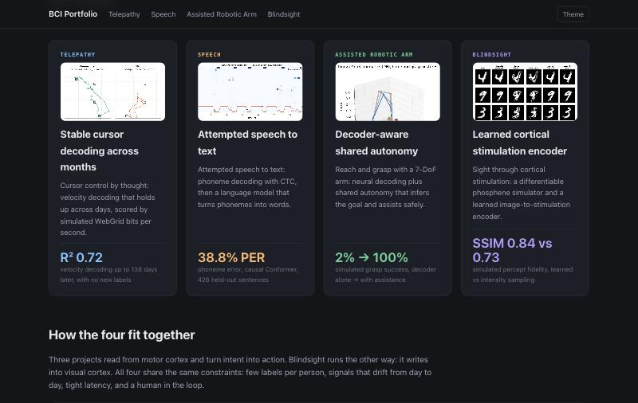
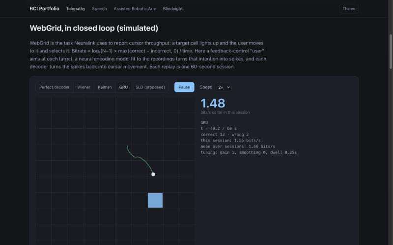
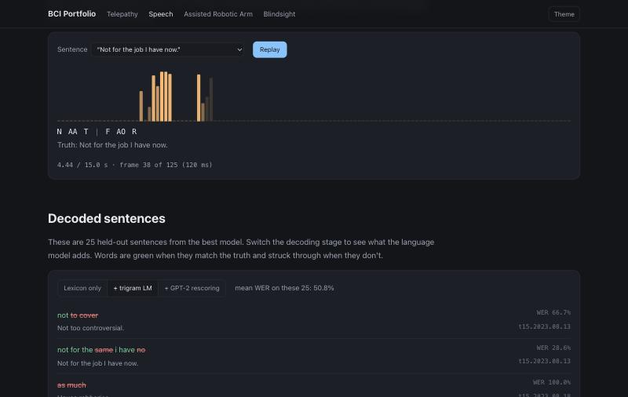
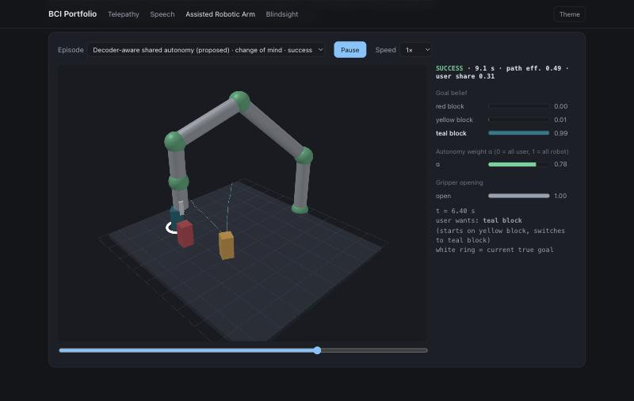
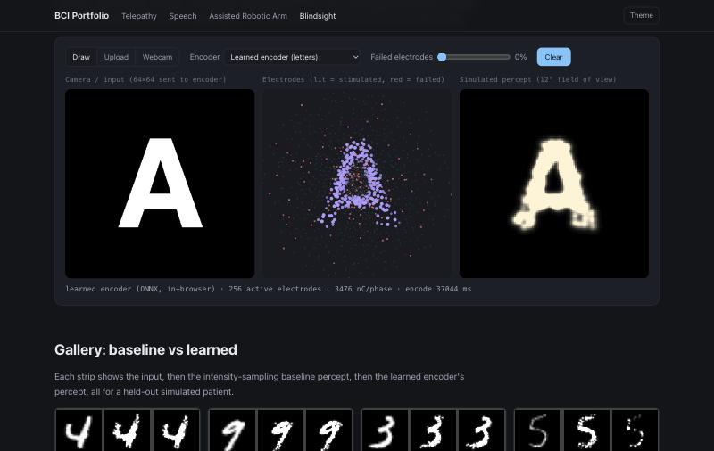
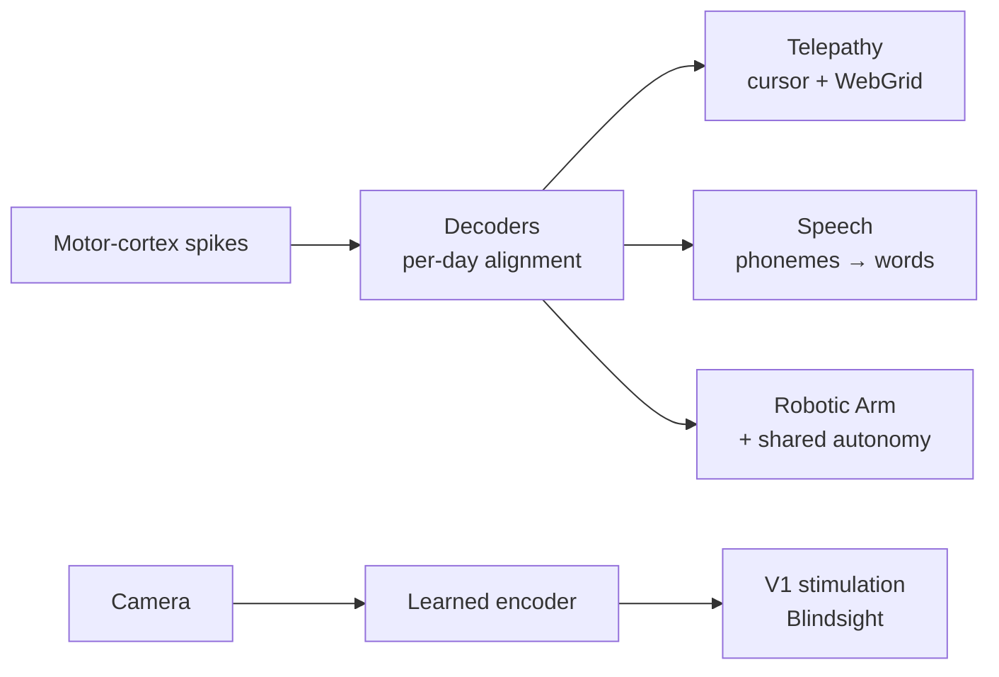

# BCI Portfolio

Four machine-learning projects for brain–computer interfaces — cursor control, speech, an assisted robotic arm and cortical vision — each with real public neural data where it exists, strong baselines, a closed-loop simulator, an interactive web demo and a full paper.

| | |
|---|---|
| **Telepathy** — cursor decoding that holds up for 4 months, scored in simulated WebGrid bits/s  | **Speech** — attempted speech → phonemes (CTC) → words (n-gram + GPT-2)  |
| **Assisted Robotic Arm** — 7-DoF decoding + decoder-aware shared autonomy  | **Blindsight** — learned, safety-bounded stimulation encoder for 1024 V1 sites  |

## Papers

- [Telepathy](papers/Telepathy.pdf) — Stable cursor decoding across months and a closed-loop WebGrid simulator
- [Speech](papers/Speech.pdf) — Decoding attempted speech from intracortical recordings on a CPU budget
- [Assisted Robotic Arm](papers/Assisted%20Robotic%20Arm.pdf) — Multi-day 7-DoF decoding and decoder-aware shared autonomy
- [Blindsight](papers/Blindsight.pdf) — Safe, patient-adaptive stimulus encoders in a differentiable phosphene simulator

## Docs

- [Instructions](docs/INSTRUCTIONS.md) — setup, run the site, reproduce each project on CPU or GPU
- [System design](docs/SYSTEM-DESIGN.md) — architecture, flows, data, decisions, testing, limits
- [File structure](docs/FILE-STRUCTURE.md) — what's where

Independent project by Amal Mehta; not affiliated with or endorsed by Neuralink. Closed-loop results come from simulated users.
