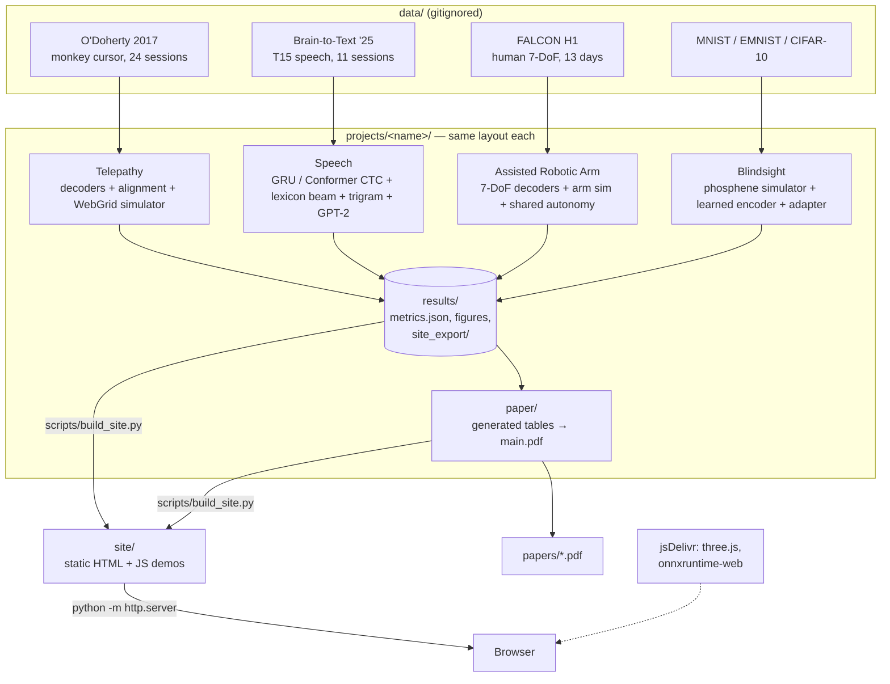

# System Design

The portfolio is four independent ML projects that share one Python environment, one results contract and one static website. Each project's own design doc goes deeper:
[Telepathy](../projects/telepathy/docs/DESIGN.md) · [Speech](../projects/speech/docs/DESIGN.md) · [Assisted Robotic Arm](../projects/robotic_arm/docs/DESIGN.md) · [Blindsight](../projects/blindsight/docs/DESIGN.md).

## Architecture

## Components

| Component | Job |
|---|---|
| `projects/telepathy` | Bins spikes, trains Wiener, Kalman, FA-stabiliser, GRU and the Stable Latent Decoder (per-day adapters plus a shared recurrent latent model). Aligns new days without labels, runs stress and few-shot tests, and runs a closed-loop WebGrid simulator (feedback-control user, encoding model fit to each day). |
| `projects/speech` | Loads and compresses Brain-to-Text '25. Trains a GRU-CTC baseline and a causal Conformer with self-conditioned CTC (day-specific input layers, augmentation). Builds a 44k-word Kneser–Ney trigram with leakage filtering, runs a lexicon-constrained beam search and GPT-2 rescoring, and covers calibration, robustness and latency. |
| `projects/robotic_arm` | Loads FALCON H1 and strips the minival bins that leak into the held-in files. Trains Wiener, Kalman, GRU, Transformer and multi-day GRU (per-day read-in) decoders. A kinematic Kinova Gen3 sim plus a simulated user drive six assistance policies, including DASA (decoder-aware Bayesian goal inference, a switching prior, a confidence gate and a safety filter). |
| `projects/blindsight` | A differentiable cortical phosphene simulator (wedge-dipole map, current spread, closed-form activation with habituation, per-patient variability). Baseline encoders, a retinotopic U-Net encoder with a hard safety layer, and a 2N-parameter patient adapter. Exports ONNX models and a JS-reproducible renderer spec. |
| `scripts/build_site.py` | Copies each `results/site_export/` and paper PDF into `site/`, and writes `site/data/headlines.json` from each project's metrics. |
| `site/` | Static pages, one per project plus a landing page. `assets/common.js` holds the nav, theme and tables; `assets/phosphene.js` is a line-for-line port of the Blindsight renderer and baseline encoder. |

## Main flows

1. **Train and evaluate (per project):** `scripts/run_cpu.sh` runs download → preprocess → train → evaluate → side studies → figures → `results/metrics.json` → `results/site_export/`. Every stage is cached and skips work already done, so an interrupted run resumes.
2. **Paper:** a table generator (`report.py`, `paper_tables.py`, `tables.py` or `make_tables.py`) turns the results JSON into LaTeX macros and tables, then `tectonic main.tex` compiles them. No number in a paper is typed by hand.
3. **Website:** `build_site.py` copies the exports, then the browser loads the JSON. Each demo replays the exported data: WebGrid sessions, reach trajectories, CTC posteriors and decodes, and arm episodes rendered with forward kinematics in three.js. Blindsight is the exception: it computes live, with the baseline encoder in JS and the learned encoder in ONNX through onnxruntime-web, then the JS phosphene renderer.
4. **Full scale:** `scripts/run_gpu.sh` runs the same code with `configs/gpu.yaml` on CUDA, then flows 2 and 3 are re-run.

## Where data lives

| What | Where | In git? |
|---|---|---|
| Raw and preprocessed datasets | `data/<project>/` | No (3.0 GB total; Speech is 2.2 GB of it) |
| Checkpoints and large intermediate runs | `projects/*/results/checkpoints`, `projects/speech/results/runs` | No |
| Metrics, logs and figures | `projects/*/results/` | Yes |
| Website copies of exports and papers | `site/data/`, `site/papers/` | Yes (generated; under 11 MB) |
| Papers | `projects/*/paper/main.pdf`, copied to `papers/<Name>.pdf` | Yes |

## Key decisions and trade-offs

- **Public data plus simulators, not synthetic-only.** Offline numbers are on real recordings (monkey cursor, human speech, human 7-DoF reach). The closed loop has to be simulated, since there is no participant, and each page and paper says so. Blindsight has no public stimulation data, so its simulator is validated against published human psychophysics instead.
- **Speech data source changed.** Dryad blocks scripted downloads, so Speech uses Brain-to-Text '25 (Card et al. 2024) from a Hugging Face mirror instead of the Willett 2023 set named in the plan.
- **CPU-first, GPU-ready.** Everything was developed and run on an 8-core Intel Mac shared by four training jobs, so the models are small and seeds are few. The same code scales through `gpu.yaml`. The trade-off is weaker absolute numbers: Speech WER of 52% against the few percent of published systems.
- **Report what happened.** Negative and mixed results are kept, for example: alignment helps only far from calibration (Telepathy); the GRU ensemble is worse than its best seed (Speech); full fine-tuning on seconds of data hurts (Arm); the learned encoder trails intensity sampling at 50% failure on natural images (Blindsight).
- **Static site, replayed data.** No server is needed, and the pages work from `http.server`. Only Blindsight runs a model live, because its encoder is 210 kB. The trade-off is that the other demos can't take new input.
- **Two CDN dependencies** (three.js, onnxruntime-web) instead of vendoring about 10 MB of wasm. If the CDN is unreachable, Blindsight falls back to the baseline encoder and the arm page shows no 3D view.
- **Shared venv, per-project packages.** No cross-project imports, so the four agents could build in parallel without coordination. The cost is some duplicated plotting and metric code.

## How it's tested

- **Unit tests per project (pytest):** shapes, metrics against hand-computed values, simulator sanity, tiny overfit tests. Counts: Telepathy 15, Speech 24, Arm 24, Blindsight 25.
  - Arm adds a test that the minival leak is stripped.
  - Speech adds LM leakage filtering.
  - Blindsight adds simulator-validation checks.
- **Cross-language check:** `projects/blindsight/tests/js/render_check.mjs` re-implements the renderer and baseline in JavaScript from the exported JSON alone, and must match the Python test cases.
  - The arm page checks its JS forward kinematics against the exported test vector on load.
- **Smoke configs:** `configs/smoke.yaml` runs each pipeline end to end in minutes.
- **Website:** checked by hand in a browser on desktop and at 375 px phone width, with no horizontal scroll.

## Known limits

- No human or animal was in the loop. All bits/s, success rates and percept metrics come from simulators.
- Results are at CPU scale: 1–3 seeds and short training (Speech 480 steps), and some ablations were trimmed when the shared machine was saturated (load averages reached 100–250). The papers list each cut.
- Cross-day Arm numbers use our own split, because FALCON's test split is private, so they are not leaderboard-comparable.
- The Telepathy data is from a monkey with 96 electrodes, not a 1024-channel human implant.
- Blindsight's "threads" layout is an idealisation, not a device specification. Its simulated thresholds (47 µA) are lower than the human data (66.8 µA).
- The GPU scripts are written but have not been run.
