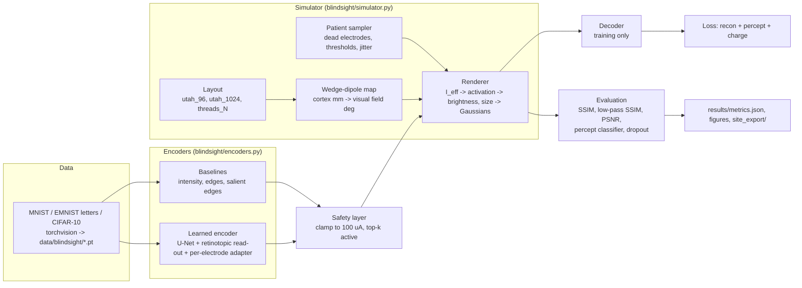

# Blindsight: system design

Blindsight is a research codebase for cortical visual prostheses. It has three parts:

- a differentiable simulator of the phosphenes produced by V1 microstimulation;
- stimulus encoders that turn camera images into per-electrode currents;
- an evaluation harness that compares those encoders on simulated patients.

No public human V1 stimulation dataset exists, so every result comes from simulation. The simulator is grounded in published psychophysics, and the ways it falls short are listed at the end of this document. This is an independent project, not affiliated with or endorsed by Neuralink.

## Architecture

## Components

| Module | Job |
|---|---|
| `cortex.py` | Wedge-dipole forward and inverse maps, cortical magnification, Horton & Hoyt reference |
| `layouts.py` | Electrode layouts on the flattened V1 surface: Utah-like grids (0.4 mm pitch) and thread-like best-candidate sites over both hemispheres |
| `simulator.py` | `SimParams` (every constant), `Patient` (per-electrode state), `sample_patient`, `PhospheneSimulator` (static, differentiable, exact and fast renderers), `TemporalSimulator` (frame-by-frame dynamics with the habituation trace) |
| `encoders.py` | Safety layer, baselines, learned encoder, decoder, percept classifier, and the bilinear read-out shared by every encoder |
| `train.py` | End-to-end training through the simulator with domain randomisation over training patients |
| `evaluate.py` | Rendering on held-out patients, metrics, percept classifier, dropout robustness, patient adaptation, per-image optimisation reference |
| `validation.py` | Checks the simulator against published curves and writes the `fig_sim_*` figures |
| `summarize.py`, `figures.py`, `export.py` | Write `metrics.json`, the result figures, and the website artefacts |
| `run.py` | Command-line entry point (`--stage data|validate|train|evaluate|ablate|adapt|diagnostics|summarize|figures|export`). Finished runs and evaluations are skipped on re-runs (`--force` recomputes), so `run_cpu.sh` resumes after an interruption. |

## Main flows

1. **Training** (`--stage train`). For each `(dataset, variant, seed)`:
   - sample a batch of images and one training patient (the patient switches every 20 steps, from a pool of 16);
   - compute `a = Safety(E(x))`, then `P = Sim(a, patient; fast, straight-through gate)`, then `x_hat = D(P)`;
   - loss `L = MSE(x_hat, x) + [MSE(P, x) + 0.5 (1 - SSIM(P, x))] + 0.05 mean(a / I_max)`;
   - optimiser: Adam with a cosine learning-rate schedule.
2. **Evaluation** (`--stage evaluate`). Five held-out patients (seeds 1000–1004).
   - Test images are assigned to patients round-robin and rendered with the exact renderer and the hard threshold.
   - Each encoder gets its own percept classifier, trained on 6k percepts (4 epochs) and tested on 2k.
   - Robustness: we add 10/25/50 % unannounced failures and re-evaluate without retraining or recalibrating.
   - Adaptation: a copy of the generic encoder is fine-tuned per patient, adapter only, on 256 unlabeled images for 150 steps.
3. **Ablations** (`--stage ablate`). Loss terms, safety limits, and electrode layouts, each trained on MNIST and compared with the intensity baseline on the same layout. Results are cached per variant in `results/eval/ablations/`.
4. **Adaptation curve and diagnostics** (`--stage adapt`, `--stage diagnostics`).
   - Adaptation curve: SSIM gain against the number of unlabeled images (16–1024), adapter-only against full fine-tuning, on two test patients.
   - Diagnostics: the share of delivered currents that are above each patient's threshold, and the median current.
5. **Export** (`--stage export`). Writes JSON, ONNX, PNG and figures for the website.

## Where data lives

| What | Where |
|---|---|
| Raw datasets and the uint8 caches | `../../data/blindsight/` (gitignored, about 0.6 GB after removing unused EMNIST splits) |
| Checkpoints | `results/runs/<dataset>_<variant>_s<seed>/{encoder.pt, decoder.pt, train_log.json}` (about 150 kB each); `results/extra_runs/` keeps the collapsed 100 µA-initialised unconstrained run for reference |
| Raw evaluation | `results/eval/*.json`, plus example percepts in `*_examples.pt` |
| Aggregates | `results/metrics.json` (the only source of numbers for the paper) and `results/validation.json` |
| Figures | `results/figures/*.png` |
| Website artefacts | `results/site_export/` (schema in the project report and inside each JSON file) |

## Design decisions and trade-offs

- **Re-implemented rather than reused dynaphos.** The dynaphos code is GPL-3.0, so we wrote our own implementation from the published equations. We changed two things:
  - Static mode uses an exact closed form for one 166 ms train from rest. It includes the habituation trace that builds up within the train, and agrees with Euler integration of the dynamics to within 1 % (unit test).
  - Gaussian sigma follows the paper's text: 2σ equals the phosphene diameter. The reference code uses half of that.
- **Separable and basis rendering.**
  - The exact renderer factorises each isotropic Gaussian into x and y profiles: memory O(B·N·(H+W)), one batched matmul.
  - Training uses a two-anchor basis: Gaussians precomputed at the mean-threshold current and at I_max, blended linearly by current. Its error against the exact renderer is below 0.03 per pixel (unit test). Evaluation always uses the exact renderer.
  - Negligible Gaussian tails are zeroed to avoid denormal floats, which slowed CPU matmuls about tenfold.
- **Display blur floor (σ_floor = 0.15°).** Intracortical phosphenes in this model are 0.05–0.3° across, often smaller than a 0.19° pixel. We add the floor in quadrature so sub-pixel phosphenes neither vanish nor alias. It is documented in the export so the website renders identically.
- **Hard threshold with a straight-through gradient.** The forward pass is always the hard detection threshold (train and test see the same percept). Gradients go through a sigmoid surrogate of width 0.1·A50.
- **Retinotopic read-out instead of a dense output layer.**
  - The encoder is fully convolutional with coordinate channels. Its map is sampled bilinearly at each phosphene's nominal location, using Gather only, so it exports to ONNX.
  - Only the 2N adapter parameters scale with N (26k parameters in total at width 24 with 1024 electrodes).
  - Per-electrode gain and bias are the only electrode-specific parameters, so they act as a patient adapter.
- **Safety enforced outside the encoder.** All encoders go through the same clamp-and-top-k layer, so comparisons are at equal safety. The learned encoder also pays a soft charge cost.
- **Low-pass SSIM.** Raw SSIM between a dotted percept and a smooth image mostly measures dot texture. We therefore also report SSIM after a 0.375° blur. Raw SSIM and PSNR are still reported, as the brief requires.
- **Recognition proxy.** A CNN trained on each encoder's percepts stands in for a user who has learned that encoding. It is an upper-bound-style proxy (no attention, memory or motor limits). It is not a psychophysics result.
- **CPU budget.** Width-24 networks, 64 px renders, 1500 steps at batch 32, and a 20k-image training subset. `configs/gpu.yaml` scales steps, data, width, patients and seeds; the code is unchanged.

## How it is tested

`pytest tests` runs 25 tests in under a minute:

- **Maps:** wedge-dipole round trip, magnification against finite differences and Horton & Hoyt, sign conventions.
- **Layouts:** counts, extents, Utah pitch.
- **Simulator:** black for zero or sub-threshold input; the threshold-current formula checked against a hand computation; monotone, bounded brightness; size trends; closed form against Euler integration; fast against exact renderer; gradient flow; dead electrodes; peak location.
- **Metrics:** SSIM matches scikit-image, PSNR matches a hand calculation, bilinear taps hit pixel centres, blur, safety layer.
- **Encoders:** output shapes and ranges.
- **Training:** a tiny overfit test.
- **Export:** the documented rendering formula and baseline algorithm, re-implemented from the JSON alone in NumPy and in plain JavaScript (`tests/js/render_check.mjs`, run through Node if it is installed), reproduce the exported test cases.

`scripts/run_cpu.sh` runs the whole pipeline end to end, followed by the tests.

## Known limits

- The simulator is a model, not data. The thresholds it produces (mean about 47 µA, from the dynaphos fit) are lower than the 66.8 ± 36.5 µA that Fernández et al. 2021 report. Several of its features are uncalibrated for intracortical arrays:
  - phosphene shape and colour;
  - interactions between electrodes (current summation; threshold reduction with simultaneous stimulation);
  - eye movements and gaze-contingent shifts;
  - long-term threshold drift.
- The cortex is a plane: there are no sulci, so the coverage of the thread layouts is optimistic. The thread layout is our assumption, not a device specification.
- Static frames only. The encoders do not exploit temporal or dynamic stimulation (Beauchamp et al. 2020) or habituation management. The temporal model is used only for validation.
- Recognition is measured by a CNN proxy, not by human observers.
- Datasets are small and low resolution (MNIST, EMNIST, 32-px CIFAR). Indoor navigation scenes are not covered.
- **End-to-end training can collapse into the sub-threshold dead zone.** Once currents fall below the rheobase and the detection threshold, gradients vanish. This happened without the percept loss, with a single 96-channel array, and in an unconstrained run initialised at 100 µA (log kept in `results/extra_runs/`). The percept-similarity term and the 50 µA initialisation prevent it in the main configuration.
- Adaptation assumes a calibrated patient-specific forward model (thresholds, dead electrodes) to backpropagate through. In a person this would come from mapping sessions, or be replaced by preference-based optimisation (Granley et al. 2023).
