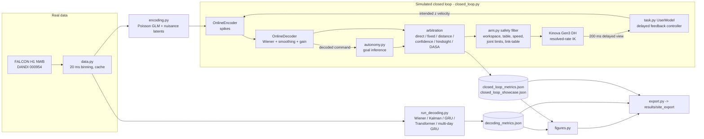

# Assisted Robotic Arm: system design

This project asks how to turn noisy intracortical decoding of 7-DoF reach-and-grasp
intent into reliable grasps with an assistive robotic arm. It has two halves:

1. **Offline decoding on real data:** FALCON H1, human, 7-DoF. We compare classic and
   neural decoders within a session and across days, including few-shot
   recalibration.
2. **A simulated closed loop:** a simulated user's intent is turned into spikes by an
   encoding model fitted to H1, decoded, arbitrated by shared autonomy, and executed by
   a safety-filtered 7-DoF arm (Kinova Gen3 kinematics). We compare assistance methods
   by task success, speed, user authority and robustness.

> **Honest scope.** The closed loop is *simulated*. No human was in the loop, and the
> user model, encoding model and arm are approximations (see "Known limits").

## Architecture

## Components

| Module | Job |
|---|---|
| `robotic_arm/data.py` | Reads the NWB files and bins spikes with FALCON's exact convention, where bin *i* covers `(t_i − 20 ms, t_i]`. Caches all 40 blocks in one `h1_binned.npz` (15 MB). Defines the splits, causal smoothing, lag features and normalisers. |
| `robotic_arm/metrics.py` | FALCON's variance-weighted R², per-DoF R² and path efficiency. |
| `robotic_arm/decoders/linear.py` | Wiener filter (ridge on strided lag taps), plus a grid search that reuses one Gram matrix and incremental sufficient statistics for pooled refits. Velocity Kalman filter with a steady-state gain and an optional leaky transition. |
| `robotic_arm/decoders/neural.py` | `SeqDecoder`: per-day linear read-ins, a GRU or causal-Transformer core, and a linear readout. Also nonstationarity augmentation (gain, offset, channel dropout), masked-MSE training with early stopping, few-shot read-in-only recalibration (core frozen, L2-anchored to the mean read-in), and full fine-tuning. |
| `robotic_arm/run_decoding.py` | The offline experiments: within-session, cross-session zero-shot and few-shot. |
| `robotic_arm/encoding.py` | Poisson GLM `log λ = b + C v + σ L f`, with `L` taken from the principal axes of residual activity and `f` an AR(1) latent. Has a streaming encoder for the closed loop. |
| `robotic_arm/arm.py` | Kinova Gen3 classical DH forward kinematics, geometric Jacobian, damped-least-squares resolved-rate control (tool-down orientation task plus yaw, null-space posture), and the safety filter. |
| `robotic_arm/task.py` | Tabletop scene, grasp rule, mapping between the decoded 7-D space and the 5-D command space, the goal-directed reach policy, and the simulated user (delay, noise, change of mind). |
| `robotic_arm/autonomy.py` | MaxEnt goal inference; the proposed decoder-aware likelihood (`DecoderErrorModel`: gain G, covariance Σ, integrated autocorrelation time τ); the arbitration policies. |
| `robotic_arm/closed_loop.py` | Simulated open-loop calibration (replays real H1 cued kinematics through the encoder), the online decoder, and the episode runner with metrics. |
| `robotic_arm/run_closed_loop.py` | Calibrates the decoder-quality levels, tunes each method on held-out seeds, runs the main sweep, the change-of-mind scenario and the ablations, computes paired McNemar tests, and records the showcase episodes. |
| `robotic_arm/figures.py`, `export.py`, `tables.py` | Paper and website figures, the `site_export` JSON, and LaTeX tables plus in-text number macros (`paper/tables/`), all generated from the result JSON. |

## Main flows

### Offline decoding (`run_decoding.py`)

**Training and validation.**
- Training data: 13 held-in calibration blocks over 6 days, 2,301 s after the minival
  bins are removed. The last 15% of each block is validation, used for hyper-parameters
  and early stopping.
- **Leakage guard.** In the public files the minival segment is the first part of the
  matching calibration file, verified bin for bin. `load_blocks()` strips it, and a unit
  test covers this. An earlier run trained on the full calibration files and scored a
  held-in GRU R² of 0.80. The log is kept in
  `results/logs/leaky_run_before_minival_fix_decoding.log`.
- Input normalisation is per day: z-scores use that day's calibration statistics. For a
  held-out day, they come from the *unlabelled* recalibration block A.
- Velocities are z-scored with the training statistics. R² is computed on raw units,
  as FALCON does.

**Within-session test.** FALCON's public held-in **minival** split, i.e. the later part
of the same blocks.

**Cross-session test.**
- 7 later days, 6-20 days after the last training day.
- On each day, block A is the recalibration block. Only its first *k* ∈ {10, 20, 45} s
  of labels are used.
- Block B, a separate later recording, is the test set.
- FALCON's own held-out evaluation split is private, so these numbers are **not**
  leaderboard-comparable.

**Methods compared.**
- Wiener: day-normalised vs global normalisation; zero-shot; trained from scratch on
  *k* s (ridge strength chosen by 2-fold CV inside those *k* s); and a pooled refit on
  held-in data plus *k* s.
- Kalman.
- GRU: zero-shot, and full fine-tuning on *k* s.
- Causal Transformer.
- **Multi-day GRU** (proposed). Per-day read-ins are trained jointly. A new day starts
  from the mean read-in (zero-shot) or gets a new read-in fitted on *k* s with the core
  frozen. Ablations: no augmentation, and fine-tuning everything.

### Closed loop (`run_closed_loop.py`)

1. **Fit the encoding model** on day 1925-01-20 (two blocks, 409 s after removing minival): a Poisson GLM
   on z-scored cued velocities, plus 8 nuisance latent directions.
2. **Simulate the calibration block.** The real cued kinematics of that day go through
   the encoder. A 10-tap Wiener filter is fitted, with 80 ms exponential output smoothing
   and a partial speed-gain correction (exponent 0.5). Decoder error statistics (G, Σ,
   τ) are measured on a simulated replay of the day's minival kinematics.
3. **Set the decoder-quality dial.** The tuning matrix C is multiplied by κ ∈ {0.75, 1,
   1.5, 2, 3}, and each κ's simulated offline R² is reported. The **nominal** level is
   the κ whose simulated R² is closest to the *real* R² of the same decoder on the same
   session (0.274).
4. **Run episodes.**
   - Each step is 20 ms. The simulated user sees the scene with a 200 ms delay and
     produces an intended velocity in decoder units (with noise).
   - That intention passes through spikes, the decoder, goal inference, arbitration,
     the safety filter and IK.
   - A grasp is tested when the gripper closes. It succeeds if the TCP is within 3 cm
     of the grasp point with yaw within 20°; closing on another object counts as a
     wrong grasp. Episodes time out after 20 s.
5. **Tune hyper-parameters fairly.** Each method's main hyper-parameters are tuned on
   separate seeds, with standard and change-of-mind episodes mixed 50/50 and the
   objective `success − wrong − 0.01·time`. The main runs use paired scenes and seeds
   across methods, so exact McNemar tests apply.

### Running on a shared machine

- **Decoders run in parts.** `run_decoding.py --parts linear` and `--parts <variant>`
  write `results/decoding_parts/*.json`, and `--merge` combines them.
  `scripts/run_cpu.sh` runs the parts `MAX_PAR` at a time.
- **Closed-loop episodes are cached.** Every finished episode is cached, keyed by a hash
  of its full specification, in `results/closed_loop_cache.jsonl`, so `--resume`
  restarts where an interrupted run stopped.
- **Pool supervision.** If a worker dies, `Pool.map` would otherwise hang. The batch
  times out instead, and the pool is rebuilt.
- **Determinism.** Episodes are fully determined by `(seed, episode index)`, so cached and
  re-run episodes are identical.

### Export (`export.py`)

Writes `metrics.json`, `episodes.json` and `decoding.json`, plus the key PNGs, to
`results/site_export/` (under 5 MB).

## Where data lives

| What | Where |
|---|---|
| Raw NWB (102 MB) | `<repo>/data/robotic_arm/000954/` (gitignored; override with `RA_DATA`) |
| Binned cache (15 MB) | `<repo>/data/robotic_arm/h1_binned.npz` |
| Metrics, logs, figures | `projects/robotic_arm/results/` (override with `RA_RESULTS`) |
| Website files | `projects/robotic_arm/results/site_export/` |

## Key design decisions and trade-offs

- **Remove minival from the calibration data.** Otherwise held-in scores are
  inflated, most of all for high-capacity models.
- **FALCON binning and metric, re-implemented and tested against sklearn.** Variance
  weighting lets the grasp dimensions dominate, so we also report per-DoF R² pooled over
  blocks. Per-block per-DoF R² is unstable, because some minival blocks have almost no
  motion in one DoF.
- **Per-day input z-scoring** is a cheap, unsupervised fix for day-to-day rate shifts,
  in the spirit of Jarosiewicz et al. 2015 mean tracking. It is applied to every
  decoder, so the comparison stays about the model.
- **Read-in-only recalibration.** A new day costs 176×64 parameters instead of the whole
  network. This is the same idea as LFADS stitching and NDT2/POYO context adaptation,
  and it is well-posed with seconds of data.
- **Kalman transition.** The least-squares transition matrix A is close to the identity
  at 20 ms and integrates observation bias. On validation a leaky `A = 0.98·I` won, and
  we report that choice.
- **Closed-loop decoder = Wiener filter.** It is FALCON's baseline and the Pitt
  clinical OLE family, and its real-data R² is easy to match. Better decoders
  correspond to moving right along the κ dial. We report the full success-vs-R² curve
  rather than a single number.
- **Command space.** Translation, wrist yaw and a single grip rate (the mean of the
  three H1 grasp dims) are used, because a parallel gripper has one DoF. Orientation is
  constrained tool-down, as in top grasps.
- **Safety filter, applied after arbitration and identical for every method:**
  - workspace box and table plane, applied before the speed cap so a blocked component
    does not use up the speed budget;
  - speed cap;
  - joint-speed scaling;
  - joint limits;
  - a link-table check that blocks only motions *moving a link further* into the
    clearance zone, which avoids deadlock.

  Constraint activations are counted.
- **The proposed DASA** changes three things relative to confidence blending:
  - the likelihood is calibrated to the decoder (G, Σ, and division by τ);
  - a switching prior;
  - a consistency gate.

  The ablations remove each one.

## How it is tested

Run `pytest tests` (about 1 minute; synthetic data only, so no download is needed).

- **Metrics:** hand-computed R², equality with sklearn's variance-weighted R², and path
  efficiency.
- **Data:** the binning convention, lag-feature causality, causal smoothing (no future
  leakage) and normaliser round-trip.
- **Kinematics:**
  - the zero-configuration height equals the sum of the DH offsets;
  - the home test vector, i.e. the TCP at (0.45, 0, 0.30) pointing down (the same
    vector is exported for the website);
  - the Jacobian against finite differences;
  - reaching and the table constraint, and the speed cap.
- **Decoders:**
  - pooled ridge from statistics equals the direct solve;
  - Wiener and Kalman reach R² > 0.8 on linear synthetic data;
  - a tiny GRU overfit drives the loss below 30% of its initial value;
  - read-in recalibration leaves the core frozen.
- **Simulator:**
  - the GLM recovers its tuning;
  - encoder firing rates are correct;
  - the command mapping round-trips;
  - goal inference concentrates on the goal and can switch;
  - the arbitration weights behave as expected (Downey's constants);
  - a full closed-loop episode with a good decoder succeeds.
- **End-to-end:** `scripts/run_cpu.sh configs/smoke.yaml` runs the whole pipeline in
  minutes.

## Known limits

- **No human in the loop.** The user model has no learning or adaptation to the
  decoder, no fatigue, and no strategy changes when assistance is active. Real users do
  adapt (Javdani 2015 found users did not always prefer the faster policy), and real
  users co-adapt with decoders.
- **The encoding model is linear-Poisson in velocity, with slow latents.** It has no
  neural dynamics, no position or goal tuning, and no condition-independent signal.
  Simulated R² is matched to the real R² for only one decoder and one session.
- **Model matching favours DASA.** DASA's likelihood uses the true structure of the
  user's policy (only the speed is perturbed in the mismatch ablation), and the
  "goals" are known object poses, i.e. perfect perception.
- **Arm simplifications:** kinematics only, with no dynamics, contact or grasp physics.
  The objects are boxes with a single top-grasp yaw. Collision checking covers
  link-table only, not link-object or self-collision.
- **Cross-session protocol.** Ours is not FALCON's private split. We have only 7
  held-out days, and the test blocks are short (about 50 s, 3 trials each).
- **CPU scale.** Neural decoders are small (a 1-layer GRU with 192 units, 1200 steps, 2 seeds).
  `configs/gpu.yaml` scales them up.
