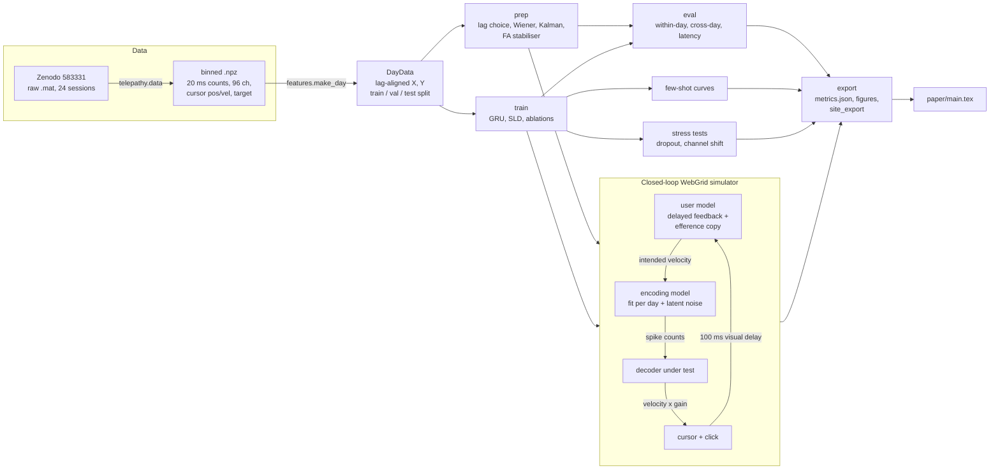

# Telepathy: system design

Cursor decoding from intracortical spiking: decoders that hold up across days, and a
closed-loop WebGrid simulator that scores them in bits per second. This is an independent
project, not affiliated with or endorsed by Neuralink.

## Architecture

## Components

| Module | Job |
|---|---|
| `telepathy/data.py` | Download each session from Zenodo (curl), merge every sorted unit and the hash unit of an M1 electrode into one threshold-crossing count per 20 ms bin, compute smoothed cursor velocity, save a ~0.7 MB `.npz`, delete the raw file. Resumable. |
| `telepathy/features.py` | `DayData`: spikes at t paired with velocity at t + lag; 60/10/30 % time split; few-shot slices = first N reaches; lag features. |
| `telepathy/linear.py` | `Decoder` interface (`predict`, `reset`/`step`, batched `reset_batch`/`step_batch`, `with_stats`), ridge Wiener filter (optionally shrunk toward prior weights), the old steady-state velocity Kalman filter (kept as `kalman_v1`), and `PVKalmanFilter`: position-velocity(-acceleration) state, tunable bin width (causal boxcar), extra neural lead, optional square-root counts, steady-state gain; this is the strong Kalman / ReFIT-KF baseline. |
| `telepathy/remap.py` | Label-free channel re-matching: per-channel statistics (rate, sd, Fano factor at 20/100 ms, autocorrelation) and channel-correlation matrices; structured hypothesis search over ~500 block re-orderings (connector/bank style) with an identity margin; optional Hungarian refinement; the stress-test partial shuffle. |
| `telepathy/clda.py` | ReFIT intention re-labelling of closed-loop sessions; closed-loop fine-tuning of the GRU (all weights, small lr) and SLD (adapter only, or adapter + velocity head), with rehearsal of offline calibration data. |
| `telepathy/stats.py` | Bootstrap CIs, paired Wilcoxon signed-rank tests, Holm correction, all-pairs comparison. |
| `telepathy/align.py` | Degenhart-style stabiliser: factor analysis + iterative stable-channel Procrustes alignment + fixed latent decoder. |
| `telepathy/models.py` | `GRUDecoder` baseline; `StableLatentDecoder` (SLD): per-day identity-initialised channel adapter, shared read-in, causal GRU (or banded ALiBi transformer) backbone, velocity head, per-day Poisson rate head. |
| `telepathy/train.py` | Training with Sussillo-style augmentation and masked-channel Poisson loss; `TorchDecoder` wrapper; NoMAD-style unsupervised adapter alignment (masked spike likelihood + Gaussian KL to calibration latents + identity penalty); few-shot adapter / GRU fine-tuning. CUDA + AMP when available. |
| `telepathy/simulator.py` | Encoding model (MLP from intended-velocity history to log-rates, low-rank AR(1) latent noise calibrated to match real decoding R^2), user model, WebGrid task with click or dwell selection and the achieved-bitrate metric. `run_webgrid_batch` runs many sessions in lock-step (vectorised over sessions; per-session gain/smoothing/hold so a whole tuning grid is one batch) with common random numbers: the target sequence, latent noise, motor noise and click randomness depend only on the session seed, so all decoders are compared on identical sessions. |
| `telepathy/experiments.py` | Cached stages: `prep`, `train`, `eval`, `kalman`, `remap`, `fewshot`, `stress`, `sim`, `simabl`, `clda`, `export`. |
| `telepathy/export.py` | All figures, `metrics.json` and `results/site_export/` built only from result files. |
| `telepathy/metrics.py` | R^2 and WebGrid bitrate. |

## Main flows

1. **Calibration.** Days 0-15 (5 sessions) are calibration days. Everything trains on their
   first 60 %; hyper-parameters are chosen on the next 10 %; within-day numbers come from
   the last 30 %.
2. **A new day without labels.** The decoder sees the new day's first 60 % as unlabelled
   spikes. Options: *fixed* (statistics of the last calibration day), *re-centred*
   (z-score with the new day's own statistics), *aligned* (SLD only: fit a fresh adapter by
   the unsupervised objective). Scored on the new day's last 30 %.
3. **Few-shot recalibration.** The first N reaches (N = 0, 1, 5, 20, 50) are labelled; the
   rest of the protocol is identical.
4. **Closed loop.** The simulated user selects WebGrid targets; the encoding model turns
   intention into spikes; the decoder moves the cursor. Gain, velocity smoothing and the
   user's click caution are tuned per decoder on separate seeds, then frozen.

## Where data lives

* Raw downloads: `ROOT/data/telepathy/raw/` (transient; deleted after conversion).
* Binned sessions: `ROOT/data/telepathy/binned/*.npz` + `manifest.json` (~18 MB total).
* Checkpoints and pickled decoders: `results/checkpoints/` (gitignored).
* Results: `results/*.json`, `results/figures/*.png`, `results/logs/`.
* Website export: `results/site_export/` (< 5 MB).

## Design decisions and trade-offs

* **Sorting-free channel counts.** Matches clinical systems and makes cross-day changes
  look like real electrode drift instead of sorting artefacts. Cost: some lost
  information relative to sorted units.
* **Per-day z-scoring for every decoder.** It makes "re-centring" (Jarosiewicz 2015) a
  free, label-free adaptation available to all decoders, so the proposed method is
  compared against the strongest cheap baseline, not a strawman.
* **Identity-initialised adapters instead of LFADS-style free read-ins.** In early runs a
  per-day free read-in (NoMAD/LFADS-style) both lowered within-day R^2 (0.71 vs 0.76) and
  made unsupervised alignment unstable. Anchoring the adapter at the identity means a new
  day starts from the re-centred decoder and alignment only moves as far as the penalty
  allows.
* **GRU backbone by default, transformer as an ablation.** On 30 minutes of
  calibration data the recurrent backbone was as accurate and cheaper per streaming step.
* **Simulator encoding model: MLP without arm position.** A paralysed user has no arm
  posture signal, so position is excluded. A Poisson GLM extrapolated more gracefully but
  lost open-loop fidelity (Wiener R^2 0.35 simulated vs 0.51 real); the MLP matches
  (0.51 vs 0.51) and is used.
* **User model with efference copy.** Without a forward model, the simulated user
  oscillates around targets because of the visual delay plus the neural lead, and every
  decoder scored near zero. The efference-copy predictor is standard in optimal feedback
  control models.
* **One torch thread for evaluation and simulation.** These stages run many tiny
  sequential operations (one 20 ms bin at a time); on a shared, overloaded CPU two
  intra-op threads made them ~15x slower than one. Training keeps two threads.
* **Headline grid 10 x 10.** All decoders score ~0 on 35 x 35 with a 96-channel Utah array
  signal; the 35 x 35 numbers are reported in the grid sweep.

## How it is tested

`tests/test_core.py` (pytest, under 2 minutes on the loaded shared CPU):
R^2 and bitrate against hand-computed values; lag features and splits; Wiener/Kalman learn a
synthetic cosine-tuned population and their streaming output equals offline output;
prior-centred ridge shrinks to the prior; the FA stabiliser recovers from partially
scrambled channels; Procrustes recovers a rotation; the attention mask is causal and banded;
SLD and GRU are causal and their streaming path equals the offline path; Gaussian KL is
zero for identical inputs; a tiny SLD overfits a synthetic day and adapter few-shot
training beats the unadapted model on a channel-permuted copy; encoder features and the
numpy forward pass match torch; a WebGrid session's bitrate matches the formula.

End to end: `CFG=configs/smoke.yaml scripts/run_cpu.sh` runs every stage with tiny models
in minutes (results in `results/smoke/`, meaningless numbers); `scripts/run_cpu.sh` is the
real CPU run.

## Results at a glance (CPU run)

* Within-day velocity R^2: SLD 0.791, GRU 0.788, Wiener 0.528, Kalman 0.193.
* Cross-day, no labels, 17 regular held-out days: SLD re-centred 0.718, SLD aligned 0.706,
  GRU re-centred 0.662, Wiener re-centred 0.422, fixed Wiener -0.037.
* Two held-out days (28, 131) are electrode re-mapping events, flagged by the label-free
  firing-rate check; re-centred decoders fail there and alignment rescues day 28 in 2 of 3 seeds.
* Simulated WebGrid 10x10: oracle 4.70, GRU 1.66, SLD 1.35, Wiener 1.27 (2.43 after ReFIT),
  Kalman 0.00 bits/s.

See `results/metrics.json` and `paper/main.pdf` for everything else.

## Known limits

* One monkey, one array, one task (random-target reaching with a real arm). The neural
  activity comes from arm movement, not from attempted movement by a paralysed person.
* The closed-loop results come from a simulator. Its open-loop fidelity is checked, but the
  closed-loop behaviour (user adaptation, learning, fatigue, click decoding) is modelled,
  not measured. Click decoding is abstracted as a latency, miss rate and false-click rate.
* CPU budget: 1,500 training steps, 3 seeds, few-shot curves on every fourth held-out day
  (5 days) with one seed, ablations with one seed and unsupervised alignment of ablations on
  every third held-out day. `configs/gpu.yaml` runs the full protocol.
* The Kalman filter is weak offline at 20 ms bins (a lag-versus-noise trade-off of the
  velocity-only state); it is tuned on validation data but not re-engineered (e.g. no
  position state, no larger bins).
